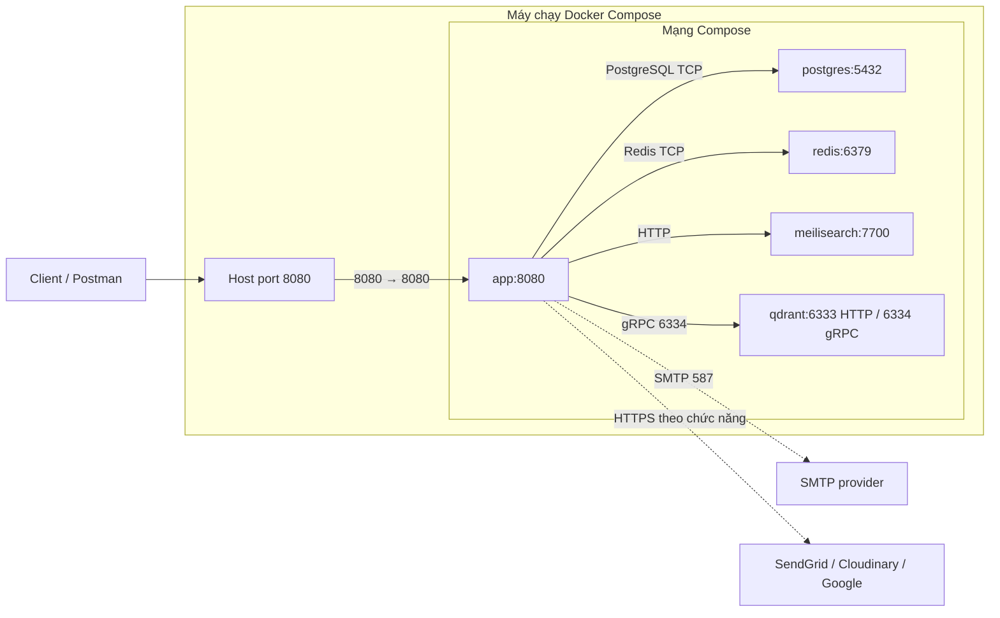
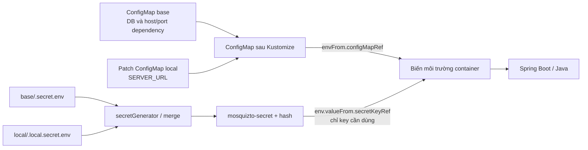

# Base: workload, mạng và cấu hình

[Về trang chính](../README.md) · [Hướng dẫn Minikube](../overlays/local/README.md)

Base cung cấp cấu hình được overlay tái sử dụng. Không apply trực tiếp thư mục này: image, namespace, public URL và các dependency local được hoàn thiện ở overlay.

## 1. Các file và trách nhiệm

- [kustomization.yaml](kustomization.yaml): đăng ký resources và tạo Secret từ `.secret.env`.
- [mosquizto-deployment.yaml](mosquizto-deployment.yaml): Pod template của backend, selector/labels, biến môi trường và tham chiếu cấu hình.
- [mosquizto-service.yaml](mosquizto-service.yaml): ClusterIP Service tên `mosquizto-service`, port `8080`. Không ghi `targetPort` thì mặc định bằng `port`, ở đây là `8080`.
- [mosquizto-config.yaml](mosquizto-config.yaml): database name/user và địa chỉ dependency không bí mật.
- [postgres.yaml](postgres.yaml): PVC `postgres-data` 2Gi, Deployment PostgreSQL một replica với chiến lược Recreate và Service `postgres:5432`.
- [.secret.env.example](.secret.env.example): danh sách key mẫu để tạo file `.secret.env` riêng, không chứa credentials thật.

Tên Deployment backend hiện là **`mosquizto-backend-deployemnt`**. Tên này viết sai chính tả nhưng hợp lệ và đang được patch theo đúng tên đó. Nếu đổi tên, phải cập nhật tất cả patch/lệnh liên quan; Kubernetes sẽ coi tên mới là resource khác.

Base khai báo image `mosquizto-backend` như một tên chung để overlay thay thế. Đây không phải xác nhận đã có image public trong registry. Base có ba replica backend; local patch giảm xuống một. WebSocket hiện dùng broker trong bộ nhớ từng tiến trình nên cần kiểm tra riêng trước khi thực sự chạy nhiều replica.

## 2. Hệ thống từ Compose



Compose publish `8080`, `5432`, `6379`, `7700`, `6333`, `6334` lên host. Nhưng backend trong mạng Compose gọi trực tiếp tên service và cổng nội bộ. Ví dụ đổi mapping database thành `15432:5432` thì backend vẫn gọi `postgres:5432`; công cụ từ host mới dùng `localhost:15432`.

Khi sang Kubernetes, `build` chuyển thành bước build/load hoặc push image riêng; hostname chuyển thành DNS của Service; volume chuyển thành PVC; healthcheck chuyển thành probe. `depends_on` không tự chuyển thành thứ tự khởi động giữa các Deployment.

## 3. Service định tuyến, ConfigMap cung cấp địa chỉ cho app

Ví dụ PostgreSQL:

```text
Backend → postgres:5432 → Service postgres → Pod được chọn bởi app=postgres
```

- `metadata.name` của Service tạo tên DNS để app tìm tới.
- `selector` của Service phải khớp labels của Pod, không phải chỉ labels ngoài cùng của Deployment.
- `port` là cổng client gọi tới Service.
- `targetPort` là cổng trong Pod; có thể là số hoặc tên từ `containers[].ports[].name`.
- `containerPort` mô tả cổng container; bản thân nó không bắt tiến trình lắng nghe hoặc mở cổng trên Windows.

Qdrant có Service HTTP `6333` và gRPC `6334`; backend hiện dùng gRPC. Một Service có nhiều port cần đặt tên riêng cho từng port. Không bắt buộc Service chuyển tiếp mọi cổng ứng dụng có thể lắng nghe.

ClusterIP là kiểu Service mặc định, phục vụ truy cập nội bộ cluster. Nó không tự publish PostgreSQL ra Internet, cũng không tự giới hạn chỉ backend được gọi DB. Cần NetworkPolicy và network plugin hỗ trợ nếu muốn hạn chế kết nối giữa các workload.

## 4. Cấu hình vào backend như thế nào?



Namespace không có một bộ env tự truyền vào mọi Pod. Mỗi container phải tham chiếu ConfigMap/Secret cần dùng.

Backend dùng `envFrom` cho ConfigMap, nên các key như `REDIS_HOST`, `QDRANT_PORT` được đưa nguyên tên vào container. `env[].valueFrom` dùng cho đổi tên hoặc chọn từng key. Ví dụ cùng `DB_PASSWORD` được cấp cho backend dưới tên `SPRING_DATASOURCE_PASSWORD`, còn PostgreSQL nhận `POSTGRES_PASSWORD`.

JDBC URL trong Deployment:

```yaml
- name: SPRING_DATASOURCE_URL
  value: "jdbc:postgresql://$(DB_HOST):$(DB_PORT)/$(DB_NAME)?options=-c%20timezone=Asia/Ho_Chi_Minh"
```

Kubernetes ghép các biến đã có từ ConfigMap/`env` khi tạo container. Biến khai báo trực tiếp trong danh sách `env` phải đứng trước biến tham chiếu tới nó. `kubectl kustomize` vẫn hiện `$(...)` vì bước render chưa phải runtime. `${DB_NAME}` là cú pháp Compose, không phải phép nội suy tự động trong ConfigMap.

`env` trực tiếp ghi đè biến cùng tên từ `envFrom`. Vì vậy không hardcode lại host/port trong patch Deployment nếu muốn ConfigMap quản lý chúng.

## 5. Secret và file env mẫu

Thực hiện các bước copy/điền file theo [README local](../overlays/local/README.md). Generator ở base đọc `.secret.env`; overlay local merge `.local.secret.env`. Cả hai file thật phải tồn tại trên máy render, dù overlay chỉ override một key.

- `DB_PASSWORD`: password khởi tạo PostgreSQL, backend phải dùng cùng giá trị.
- `JWT_ACCESS_KEY`, `JWT_REFRESH_KEY`, `JWT_RESET_KEY`: ba key Base64 độc lập. Có thể sinh từng key bằng `openssl rand -base64 48` nếu đã cài OpenSSL.
- `MEILI_MASTER_KEY`: dùng nhất quán giữa Meilisearch server và backend.
- `MAIL_ADDRESS`, `MAIL_USERNAME`, `MAIL_PASSWORD`: ánh xạ sang các biến `SPRING_MAIL_*`; cung cấp SMTP credentials hợp lệ khi dùng SMTP.
- `GOOGLE_CLIENT_ID`, `CLOUDINARY_*`, `SEND_GRID`: cấu hình nhà cung cấp theo chức năng và mail provider đã chọn.
- `WS_*`, `SERVER_NAME`, `MAIL_FROM`, `MAIL_NAME`, `APP_MAIL_PROVIDER`: giữ nguồn env-file hiện có; không phải tất cả đều là bí mật.

File ví dụ chỉ có placeholder; không bảo đảm app chạy với các chuỗi `REPLACE_WITH_...`. Backend có một số bean đọc cấu hình ngay khi startup, nên không mặc định tính năng chưa dùng thì có thể bỏ key. `SEND_GRID` có thể rỗng khi chọn SMTP; khi chọn SendGrid phải cấp API key hợp lệ.

Kustomize thêm hash vào tên Secret và cập nhật reference trong Deployment. Sửa một key trong Secret dùng chung có thể rollout cả các workload đang tham chiếu nó. Base64 không phải mã hóa bảo mật; không commit Secret đã render, file env thật hay private key.

## 6. Lưu trữ, startup và giới hạn của base

- PostgreSQL mount `/var/lib/postgresql/data`, dùng `PGDATA=/var/lib/postgresql/data/PGDATA` và readiness `pg_isready`. PVC dựa vào default StorageClass; PVC Bound chưa chứng minh app đăng nhập được DB.
- PostgreSQL env dùng để khởi tạo database mới. Đổi Secret không tự đổi password đã lưu trong database; không xóa PVC để chữa lỗi credentials.
- Backend bật Flyway; migration có dữ liệu seed và extension `pg_trgm`. Kiểm tra trước khi dùng DB ngoài hoặc dữ liệu thật.
- Meilisearch và Qdrant được gọi trong quá trình khởi tạo backend. Dựng dependency trước khi cần kiểm tra startup; một lần apply toàn bộ có thể làm backend restart trong lúc dependency chưa Ready.
- Redis giữ cả token, rate limit và idempotency, không chỉ cache. PVC không thay thế việc chọn chính sách persistence và backup.
- Thiếu model ONNX thì embedding bị tắt; điều đó không tự tắt bean Qdrant.
- Giá trị tài nguyên/PVC hiện dành cho lab. Chưa phải thiết kế HA hay sizing EKS.

## Tham chiếu

- [Kustomize](https://kubernetes.io/docs/tasks/manage-kubernetes-objects/kustomization/).
- [Service và các loại Service](https://kubernetes.io/docs/concepts/services-networking/service/).
- [Biến môi trường phụ thuộc nhau](https://kubernetes.io/docs/tasks/inject-data-application/define-interdependent-environment-variables/).
- [Persistent Volumes](https://kubernetes.io/docs/concepts/storage/persistent-volumes/).
- [PostgreSQL official image](https://hub.docker.com/_/postgres).
