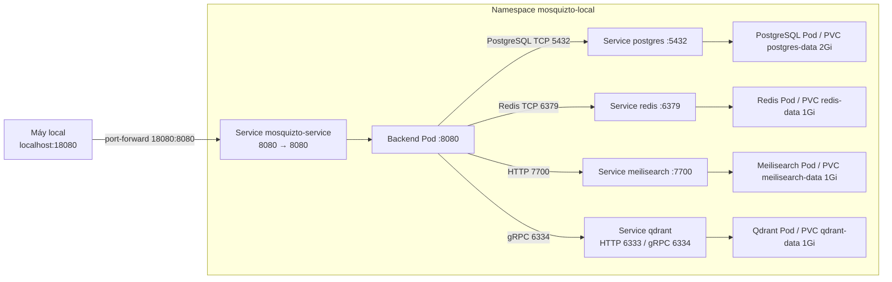

# Local: chạy Mosquizto trên Minikube

[Về trang chính](../../README.md) · [Cách base hoạt động](../../base/README.md)

Các lệnh PowerShell dưới đây chạy từ **thư mục gốc `mosquizto-gitops`**, không phải thư mục `overlays/local`. Profile/context ví dụ là `minikube`; namespace là `mosquizto-local`.

## 1. Overlay này bổ sung gì?

- [kustomization.yaml](kustomization.yaml): dùng base, thêm namespace/dependency local, merge Secret và đăng ký patches.
- [namespace.yaml](namespace.yaml): namespace `mosquizto-local`.
- [image.yaml](image.yaml): backend image `mosquizto-backend:local-001`, `imagePullPolicy: Never`, một replica, tài nguyên và HTTP startup/readiness probes.
- [mosquizto-config.yaml](mosquizto-config.yaml): patch `SERVER_URL=http://localhost:18080/` cho truy cập qua port-forward bên dưới.
- [redis.yaml](redis.yaml), [meilisearch.yaml](meilisearch.yaml), [qdrant.yaml](qdrant.yaml): workload, Service và PVC riêng cho dependency local.
- [.local.secret.env.example](.local.secret.env.example): mẫu override các key env của base, hiện minh họa `SERVER_NAME`.



Mọi Service hiện là ClusterIP, không có cấu hình public load balancer. Hostname ngắn hoạt động giữa các Pod cùng namespace. Cổng của Service là nơi backend gọi tới; `targetPort` chuyển tiếp tới port tương ứng trong Pod.

## 2. Chuẩn bị

Cần Docker Desktop đang chạy, Minikube, `kubectl`, source backend và Internet để tải image/dependency lần đầu. Build bằng Dockerfile không yêu cầu cài Maven/JDK trên host.

Nếu backend nằm cạnh repo này theo bố cục workspace:

```text
NT548/
  mosquizto-backend/
  mosquizto-gitops/
```

thì đường build ở mục 4 dùng được. Nếu checkout chỗ khác, thay đường dẫn build bằng đường tới backend thực tế.

Khởi động hoặc kiểm tra Minikube:

```powershell
minikube start -p minikube --driver=docker
kubectl config get-contexts
kubectl --context=minikube get nodes
kubectl --context=minikube get storageclass
```

Node cần Ready; PVC dựa vào default StorageClass. Requests/limits hiện là mức lab, cần xem tài nguyên máy khi Pod Pending/OOMKilled, không coi chúng là sizing production.

## 3. Tạo hai file env riêng

Chỉ copy nếu file chưa có, tránh ghi đè credentials local đang dùng:

```powershell
if (-not (Test-Path base/.secret.env)) {
    Copy-Item base/.secret.env.example base/.secret.env
}
if (-not (Test-Path overlays/local/.local.secret.env)) {
    Copy-Item overlays/local/.local.secret.env.example overlays/local/.local.secret.env
}
```

Mở hai file thật và điền giá trị hợp lệ theo [hướng dẫn base](../../base/README.md#5-secret-và-file-env-mẫu). File local override key trùng tên từ base; giữ các key chung ở base, chỉ ghi phần khác biệt ở local.

Không cần copy nguyên `.env` của backend: Compose trước đây ánh xạ `DB_PASSWORD` sang `SPRING_DATASOURCE_PASSWORD`, `MAIL_*` sang `SPRING_MAIL_*` và ghép JDBC URL. Manifest hiện đã làm các phép ánh xạ đó. DB name/user nằm trong ConfigMap; không cần lặp chúng trong Secret mẫu.

Kiểm tra file thật được ignore và file mẫu vẫn được Git nhận:

```powershell
git check-ignore base/.secret.env overlays/local/.local.secret.env
git status --short --untracked-files=all
```

Không đưa output Secret, access token hay file render chứa Secret vào commit. Nếu một file thật đã được track từ trước thì `.gitignore` không tự bỏ track file đó.

## 4. Build và nạp image backend

```powershell
docker build -t mosquizto-backend:local-001 ../mosquizto-backend
minikube -p minikube image load mosquizto-backend:local-001
minikube -p minikube image ls
```

Minikube có kho image riêng; build trên Docker Desktop chưa đủ. Policy `Never` yêu cầu đúng image/tag đã tồn tại trên node. Khi build phiên bản mới, chọn tag khác, load lại và sửa `image.yaml` để Deployment rollout đúng nội dung.

Dockerfile mặc định bỏ tải model ONNX. Muốn kiểm tra embedding, thêm `--build-arg INCLUDE_EMBEDDING_MODEL=true` lúc build rồi đo lại tài nguyên. Không thêm biến này vào env runtime và kỳ vọng model tự được tải.

## 5. Render, dry-run và apply

```powershell
kubectl kustomize ./overlays/local | Out-Null
if ($LASTEXITCODE -ne 0) { throw "Kustomize render failed" }
kubectl --context=minikube apply --dry-run=server -k ./overlays/local
if ($LASTEXITCODE -ne 0) { throw "Server validation failed" }
kubectl --context=minikube apply -k ./overlays/local
```

Không bỏ `Out-Null` rồi chia sẻ toàn bộ YAML render: trong đó có Secret base64. Không dùng `--validate=false` để bỏ qua lỗi tên trường/kiểu dữ liệu.

Kiểm tra:

```powershell
kubectl --context=minikube -n mosquizto-local get deployments,pods,svc,pvc
kubectl --context=minikube -n mosquizto-local rollout status deployment/postgres --timeout=180s
kubectl --context=minikube -n mosquizto-local rollout status deployment/mosquizto-backend-deployemnt --timeout=360s
kubectl --context=minikube -n mosquizto-local get endpointslices
```

Lần đầu tải image, backend có thể restart trong lúc dependency chưa sẵn sàng. Cả năm Deployment cần Ready và số restart cần ổn định sau startup. Probe backend hiện gọi `/v3/api-docs`, kiểm tra được HTTP nhưng chưa phải health endpoint đánh giá đầy đủ dependency.

## 6. Mở Swagger và test bằng Postman

Mở terminal riêng, chạy và giữ lệnh:

```powershell
kubectl --context=minikube -n mosquizto-local port-forward service/mosquizto-service 18080:8080
```

- Swagger: `http://localhost:18080/swagger-ui/index.html`.
- OpenAPI: `http://localhost:18080/v3/api-docs`.
- Login: `POST http://localhost:18080/auth/login`, JSON chứa `username` và `password` của tài khoản test hợp lệ.

`18080` là cổng trên máy bạn; backend trong container vẫn lắng nghe `8080`. `SERVER_URL` là địa chỉ app dùng cho Swagger/link email, không phải cổng cấu hình HTTP listener.

Bạn cũng có thể dùng cách đã thực hành trên máy Windows:

```powershell
minikube -p minikube service mosquizto-service -n mosquizto-local
```

Tùy phiên bản/driver và Service, lệnh có thể tạo tunnel localhost hoặc báo hạn chế của ClusterIP; nếu không truy cập được, dùng port-forward. Nếu nhận URL với port động, giữ terminal và dùng đúng URL vừa in. Không hardcode port động vào repo. Postman có thể gọi URL tunnel, nhưng link do app sinh vẫn dùng `SERVER_URL`; muốn khớp thì cập nhật patch ConfigMap hoặc dùng port-forward cố định.

Thử tiếp API cần token, ghi/đọc DB và search theo Swagger thực tế. Không commit credentials seed hoặc JWT vào tài liệu/Postman export công khai.

## 7. Sửa cấu hình và triển khai lại

- Host/port dùng chung: sửa `base/mosquizto-config.yaml`.
- URL riêng local: sửa patch `overlays/local/mosquizto-config.yaml`.
- Secret riêng: sửa file env thật, không sửa `.example` bằng giá trị thật.
- Image/tag, replicas, probes, resources: sửa `image.yaml`.

Render, dry-run rồi apply lại. Pod không tự nhận biến môi trường mới chỉ vì ConfigMap có tên cố định được cập nhật; nếu Pod template chưa đổi, cần rollout lại backend:

```powershell
kubectl --context=minikube -n mosquizto-local rollout restart deployment/mosquizto-backend-deployemnt
```

Generator Secret có hash sẽ cập nhật reference, thường tạo rollout cho các workload tham chiếu khi apply. Việc này vẫn không đổi password trong PostgreSQL đã khởi tạo. Không xóa PVC/namespace để chữa lỗi cấu hình.

## 8. Xem CPU/RAM, dung lượng và debug

Nếu chưa có Metrics Server, có thể bật addon Minikube. Nếu đã cài thủ công, không cài chồng thêm addon trước khi xác định cách quản lý:

```powershell
minikube -p minikube addons enable metrics-server
```

Chờ Metrics API sẵn sàng rồi xem:

```powershell
kubectl --context=minikube top pods -n mosquizto-local --sum
kubectl --context=minikube top nodes
kubectl --context=minikube -n mosquizto-local get pvc
kubectl --context=minikube -n mosquizto-local exec deployment/postgres -- du -sh /var/lib/postgresql/data
```

`top` là số liệu CPU/RAM gần hiện tại; PVC capacity là dung lượng được cấp/báo cáo, không phải số byte đang dùng. `du` đo riêng thư mục dữ liệu PostgreSQL. Minikube hostpath không nhất thiết giới hạn disk cứng theo con số request của PVC.

Nếu Metrics API không khả dụng, đọc log:

```powershell
kubectl --context=minikube -n kube-system logs deployment/metrics-server --tail=60
kubectl --context=minikube get apiservice v1beta1.metrics.k8s.io
```

Trong phiên lab 28/10, Metrics Server cài từ manifest upstream lỗi chứng chỉ kubelet thiếu IP SAN. Thêm `--kubelet-insecure-tls` vào args Deployment Metrics Server trên Minikube đã khắc phục. Cờ này bỏ xác minh chứng chỉ kubelet, chỉ là lựa chọn cho lab; không sao chép làm mặc định EKS. Thay đổi addon này không nằm trong app overlay của repo. [Tài liệu Metrics Server](https://github.com/kubernetes-sigs/metrics-server#requirements).

Đọc lỗi workload:

```powershell
kubectl --context=minikube -n mosquizto-local describe pods -l app=postgres
kubectl --context=minikube -n mosquizto-local logs -l app=mosquizto-backend --tail=100 --prefix=true
kubectl --context=minikube -n mosquizto-local get events --sort-by=.lastTimestamp
```

Với Pod crash, dùng `get pods` lấy tên, rồi `logs TEN_POD --previous` để xem lần chạy trước. Trong rollout có thể còn cả Pod cũ/mới; đối chiếu tên Pod và revision thay vì mặc định log Deployment luôn thuộc bản mới nhất.

- `ErrImageNeverPull`: chưa load đúng image/tag vào Minikube.
- `CreateContainerConfigError`: thiếu Secret/ConfigMap/key hoặc sai namespace.
- PostgreSQL Running nhưng không Ready: xem lệnh probe; shell cần `sh -c`.
- `URL must start with jdbc`: sai giá trị/nguồn `SPRING_DATASOURCE_URL`; chưa phải lỗi password DB.
- Connection refused: kiểm tra dependency Ready, endpoint Service, port và hostname.
- Qdrant: backend phải dùng gRPC `6334`, không phải HTTP `6333`.
- `Could not resolve placeholder`: thiếu env app đọc; đối chiếu cả `application.yml` và `@Value` trong Java.
- Pod Pending: xem PVC, StorageClass, requests và tài nguyên node.
- OOMKilled: đo memory, kiểm tra limits và model ONNX nếu có.

## 9. Những giới hạn còn lại trước EKS/GitOps

- Chưa có overlay EKS/Argo CD; Argo CD không đọc được các file env bị ignore trên máy Đạt.
- Qdrant vẫn dùng `latest` giống Compose; cần chốt version/digest đã test trước khi bàn giao.
- Database/search đang chạy một instance cho lab, chưa có HA/backup hoàn chỉnh. Giữ PVC không thay thế backup.
- Chưa có health endpoint chuyên biệt; Qdrant readiness chỉ thử cổng gRPC, không kiểm tra collection.
- PostgreSQL, Redis và search placement trên EKS, credentials, storage/CSI, ingress và monitoring cần phối hợp nhóm trước khi triển khai cloud.
- Flow cuối: Jenkins cập nhật GitOps repo, Argo CD reconcile. Các lệnh apply local trong tài liệu dùng để học/kiểm chứng trên Minikube.

## Tham chiếu

- [Minikube: local images](https://minikube.sigs.k8s.io/docs/handbook/pushing/).
- [Kubernetes: probes](https://kubernetes.io/docs/tasks/configure-pod-container/configure-liveness-readiness-startup-probes/).
- [kubectl top](https://kubernetes.io/docs/reference/kubectl/generated/kubectl_top/kubectl_top_pod/).
